<p align="center">
  <a href="https://tigertag-project.github.io/TigerQR-Label/">
    <picture>
      <source media="(prefers-color-scheme: dark)" srcset="brand/logo_tigertag_head.svg">
      
    </picture>
  </a>
</p>

<h1 align="center">TigerQR Label: the QR label of the TigerTag ecosystem</h1>

<p align="center">
  <a href="https://tigersystem.io/playground-tigerqr">
    
  </a>
  <br>
  <a href="https://tigertag-project.github.io/TigerQR-Label/">
    
  </a>
</p>

<p align="center">
  <a href="https://tigertag-project.github.io/TigerQR-Label/">Reference site</a>
  ·
  <a href="https://tigersystem.io/playground-tigerqr">TigerQR Playground</a>
  ·
  <a href="https://tigersystem.io/en/tiger-qr-labels">TigerQR on tigersystem.io</a>
  ·
  <a href="https://wiki.tigersystem.io/developers/spool-ids-and-qr-links/">Link contract</a>
  ·
  <a href="https://github.com/TigerTag-Project/TigerTag-RFID-Guide">TigerTag protocol</a>
</p>

[](https://tigertag-project.github.io/TigerQR-Label/)
[](https://tigersystem.io/playground-tigerqr)
[](https://github.com/TigerTag-Project/TigerQR-Label/actions/workflows/pages.yml)
[](https://github.com/TigerTag-Project/TigerQR-Label/actions/workflows/check.yml)
[](LICENSING.md)
[](LICENSING.md)
[](#the-nine-label-formats)
[](#how-a-label-is-drawn)

> **TigerQR** is the QR label of the TigerTag ecosystem: a sticker for a 3D-printing filament
> spool whose QR code opens the right page on any phone, with no app. **TigerQR+** is the same
> label when it is linked to a product of the TigerTag+ catalogue; **TigerQR** when it is not,
> the same logic as TigerTag and TigerTag+. Every label carries one short link on
> `qr.tigertag.io`, and the path alone says what it is.

<p align="center">
  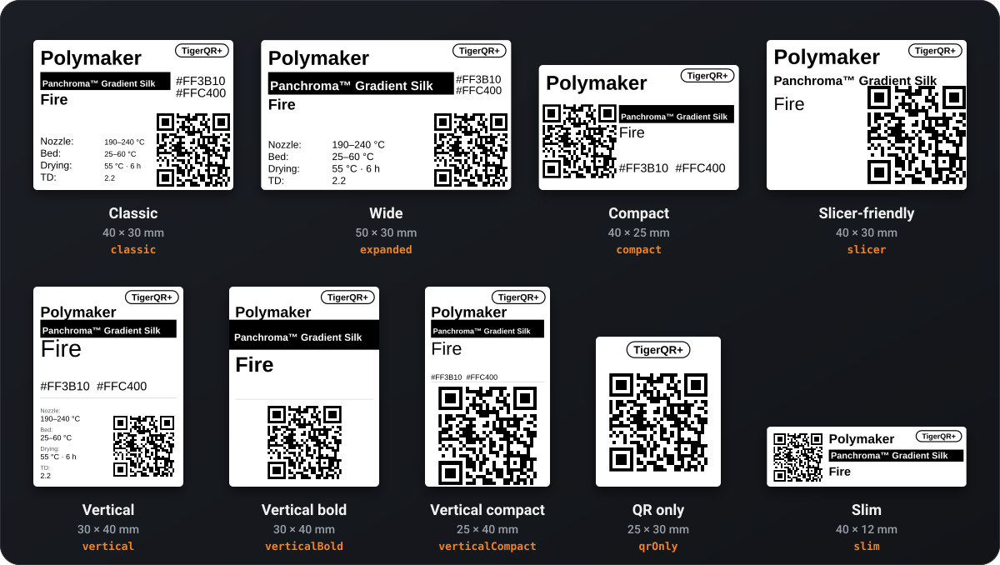
</p>

This repository is the public reference for what a TigerQR label prints and what its link means:
the specification, the test vectors every reader is checked against, the reference code
`qr.tigertag.io` runs, the example labels and the
[reference site](https://tigertag-project.github.io/TigerQR-Label/) built from them.

---

## Contents

- [Where to start](#where-to-start)
- [TigerQR and TigerQR+](#tigerqr-and-tigerqr)
- [One scan, three links](#one-scan-three-links)
- [Who gets what](#who-gets-what)
- [Endings for tools: `.json` and `.ttag`](#endings-for-tools-json-and-ttag)
- [Shared links and the language prefix](#shared-links-and-the-language-prefix)
- [Spool Label and Filament Label](#spool-label-and-filament-label)
- [The nine label formats](#the-nine-label-formats)
- [How a label is drawn](#how-a-label-is-drawn)
- [Reading a link](#reading-a-link)
- [Building a link](#building-a-link)
- [Code examples](#code-examples)
- [Testing against the test vectors](#testing-against-the-test-vectors)
- [Make a label](#make-a-label)
- [The public label API](#the-public-label-api)
- [Repository layout](#repository-layout)
- [Related](#related)
- [Licence](#licence)

---

## Where to start

| If you want to | Go to |
|---|---|
| Make a label for a catalogue product, in every format | **[TigerQR Playground](https://tigersystem.io/playground-tigerqr)** |
| See the labels explained, and build a link | **[Reference site](https://tigertag-project.github.io/TigerQR-Label/)** · [tigersystem.io/en/tiger-qr-labels](https://tigersystem.io/en/tiger-qr-labels) |
| Read a scanned link in your own app | [Reading a link](#reading-a-link), [`src/parse.ts`](src/parse.ts), [`test-vectors/links.json`](test-vectors/links.json) |
| Print the link of a spool or a product | [Building a link](#building-a-link), [`src/links.ts`](src/links.ts) |
| Draw a label in your own app or site | [How a label is drawn](#how-a-label-is-drawn), [The public label API](#the-public-label-api) |
| Every edge case of the contract | [Spool ids and QR links](https://wiki.tigersystem.io/developers/spool-ids-and-qr-links/) |

The detailed specification is in [`spec/links.md`](spec/links.md) (the links, how they are read,
what they answer) and [`spec/labels.md`](spec/labels.md) (the formats and how a label is drawn).

---

## TigerQR and TigerQR+

<p align="center">
  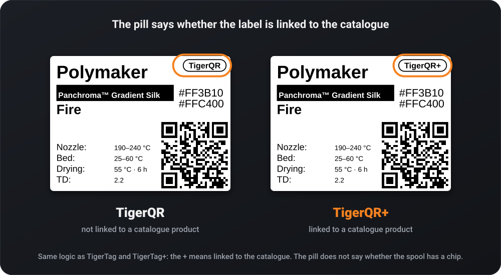
</p>

The outlined pill in the corner of every label is its name:

| Pill | When | Like |
|---|---|---|
| **TigerQR+** | the label's reference is a catalogue product (a real `id_product`) or a TigerTag+ chip; every Filament Label | TigerTag+ |
| **TigerQR** | anything else, so a TigerTag chip with no product gives TigerQR | TigerTag |

As with TigerTag and TigerTag+, the `+` means linked to the catalogue. The pill does not say
whether the spool has a chip: a spool without a chip (TigerData+) linked to a product is TigerQR+.

---

## One scan, three links

Every label points to `https://qr.tigertag.io/`. The path says what it is, so an app reads it
offline, without the website.

| Label on | Link | What the path is |
|---|---|---|
| a spool with a chip (TigerTag, TigerTag+) | [`qr.tigertag.io/1d33dbda0d1080`](https://qr.tigertag.io/1d33dbda0d1080) | The chip's NFC UID in hex, 14 characters. The twin chip's UID opens the same spool. |
| a spool without a chip (TigerData, TigerData+) | [`qr.tigertag.io/6130922252`](https://qr.tigertag.io/6130922252) | The TigerData id without its `TigerData_` prefix, 10 or 17 digits. The long form `TigerData_6130922252` opens too. |
| a catalogue product (TigerQR+) | [`qr.tigertag.io/p/2673739332`](https://qr.tigertag.io/p/2673739332) | `p/` and the `id_product` in decimal, always 10 digits with leading zeros ([`p/0010303748`](https://qr.tigertag.io/p/0010303748)). Labels printed with 8 hex characters ([`p/9f5e0644`](https://qr.tigertag.io/p/9f5e0644)) still open. |

Links are printed lowercase and read in any case. Nothing is printed in clear next to the code:
the QR code is the way back to the spool or the product.

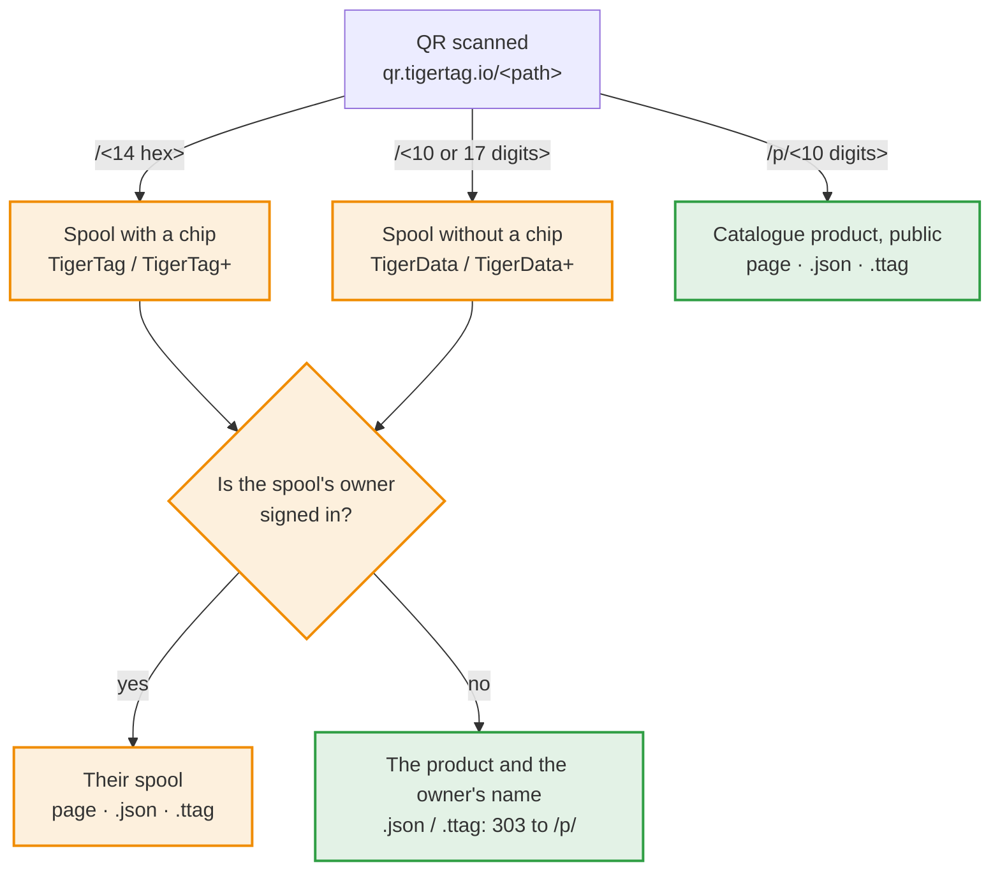

Orange is private to the spool's owner; green is public.

## Who gets what

| Link | The owner, signed in to their TigerSystem account | Anyone else (not signed in, another account, a friend) |
|---|---|---|
| Spool | the spool | the spool's catalogue product and the owner's display name, never the spool itself |
| Product | the catalogue product | the catalogue product, with no sign-in |

- A product link (`p/…`) answers a `302` to the product's catalogue page on tigersystem.io.
- A spool with no catalogue product shows a private page to anyone but its owner.
- Nothing of the spool itself (weight, note, location) is ever shown to anyone else.
- A spool link may carry `?weight=<grams>` and `?note=<text>`; they are passed on to the owner's
  spool page. These links are never printed.
- A product that left the catalogue (unknown, archived, merged) answers one "forgotten product"
  page with status `404`.

## Endings for tools: `.json` and `.ttag`

Add `.json` (the data) or `.ttag` (the file Tiger Studio imports) to any link to build your own
interface: [`/p/2673739332.json`](https://qr.tigertag.io/p/2673739332.json),
[`/p/2673739332.ttag`](https://qr.tigertag.io/p/2673739332.ttag). The ending is read in any case.

| Link | The owner (`Authorization: Bearer <ID token>`) | Anyone else |
|---|---|---|
| `…/p/<id>.json` | the catalogue record (`?lang=` picks the text language), cacheable, any origin | the same |
| `…/p/<id>.ttag` | the TigerData+ record Tiger Studio creates from the product, as a file to import | the same |
| `…/<spool id>.json` | the spool | `303` to the product's `.json` (`404` without a product) |
| `…/<spool id>.ttag` | the spool as a `.ttag` file | `303` to the product's `.ttag` (`404` without a product) |

A product that left the catalogue answers `{"error":"not-in-catalogue"}` with status `404`.

## Shared links and the language prefix

A link that is shared (from a Share button, never printed) may start with the sharer's language:
[`qr.tigertag.io/fr/p/2673739332`](https://qr.tigertag.io/fr/p/2673739332). The page and its preview
on social networks then open in that language for everyone, link-preview crawlers included.

- `<lang>` is one of `en`, `fr`, `de`, `es`, `it`, `zh`, `pt`, `pt-pt`, `pl`, `ru`, `nl`,
  written lowercase and read in any case.
- Without a prefix, the visitor's browser language decides. An unknown prefix answers `404`.
- **Readers strip it.** A reader handed a link (an app that scans or pastes one) drops one leading
  `/<lang>/` first, then reads the rest: `/fr/p/2673739332` is the product `/p/2673739332`.
- **Printed labels never carry it.** A reader never stores or prints the prefix: a label made from
  a shared link carries the bare link, so a printed QR stays the same in every country.

The reference is `splitLangPrefix` in [`src/parse.ts`](src/parse.ts).

---

## Spool Label and Filament Label

<p align="center">
  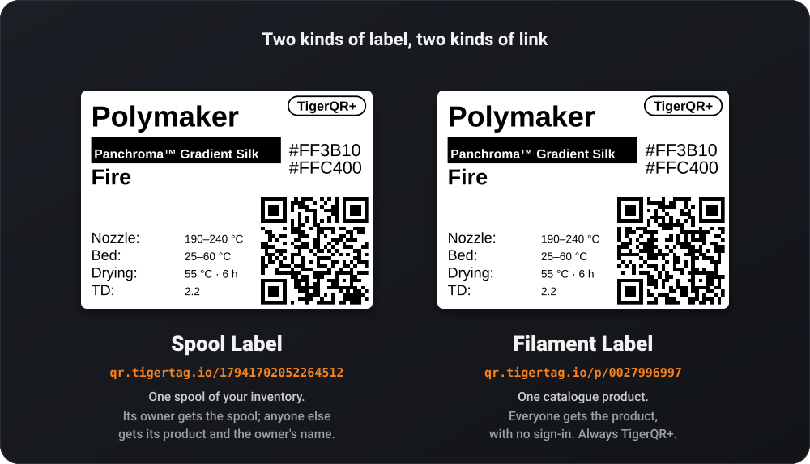
</p>

| Label | Its QR code | Printed for | Pill |
|---|---|---|---|
| **Spool Label** | the spool link | a spool of your inventory that has a QR link | TigerQR+ or TigerQR |
| **Filament Label** | the product link | a catalogue product: a swatch, a shelf, a showroom | always TigerQR+ |

The owner scanning a Spool Label gets the spool; anyone else gets its product. A Filament Label
opens the product for everyone.

**What a label carries**

- the brand;
- the series in white on a black bar (the material when there is no series);
- the colour name, and its hex code(s);
- the TigerQR or TigerQR+ pill;
- up to four value slots, chosen among nozzle range, bed range, drying (temperature and time), TD
  and diameter;
- the QR code.

Only what does not change: never the remaining weight, the note, the rack or the owner.

---

## The nine label formats

Every format exists as a Filament Label and as a Spool Label. The example labels below are drawn
by the label renderer Tiger Studio and tigersystem.io share, for a Polymaker Panchroma Gradient Silk
Fire (`id_product` 27996997), at 300 dpi. Every QR decodes to its link.

| Format | Id | Size (mm) | Value slots | Filament Label (TigerQR+) | Spool Label |
|---|---|---|---|---|---|
| Classic | `classic` | 40 × 30 | 4 | 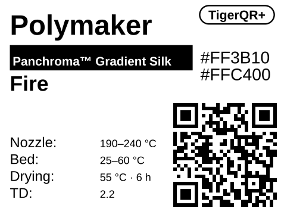 | [TigerQR+](examples/spool/tigerqr-plus/label-classic-40x30.svg) · [TigerQR](examples/spool/tigerqr/label-classic-40x30.svg) |
| Wide | `expanded` | 50 × 30 | 4 | 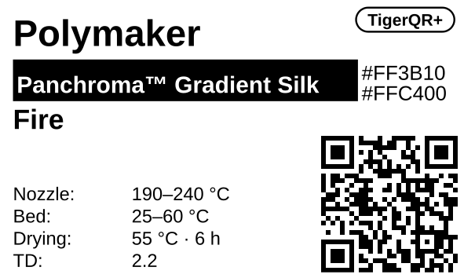 | [TigerQR+](examples/spool/tigerqr-plus/label-wide-50x30.svg) · [TigerQR](examples/spool/tigerqr/label-wide-50x30.svg) |
| Compact | `compact` | 40 × 25 | 0 | 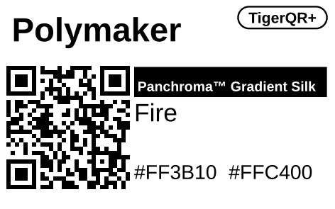 | [TigerQR+](examples/spool/tigerqr-plus/label-compact-40x25.svg) · [TigerQR](examples/spool/tigerqr/label-compact-40x25.svg) |
| Slim | `slim` | 40 × 12 | 0 | 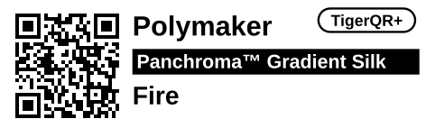 | [TigerQR+](examples/spool/tigerqr-plus/label-slim-40x12.svg) · [TigerQR](examples/spool/tigerqr/label-slim-40x12.svg) |
| Slicer-friendly | `slicer` | 40 × 30 | 0 | 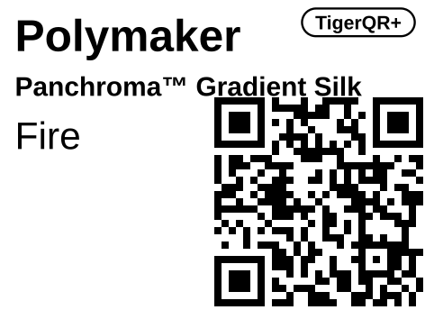 | [TigerQR+](examples/spool/tigerqr-plus/label-slicer-40x30.svg) · [TigerQR](examples/spool/tigerqr/label-slicer-40x30.svg) |
| Vertical | `vertical` | 30 × 40 | 4 | 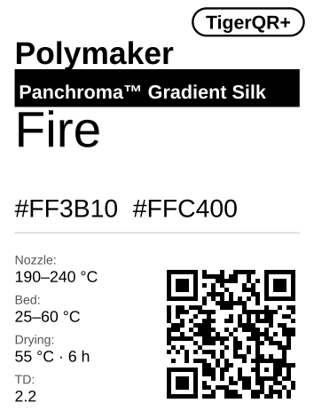 | [TigerQR+](examples/spool/tigerqr-plus/label-vertical-30x40.svg) · [TigerQR](examples/spool/tigerqr/label-vertical-30x40.svg) |
| Vertical bold | `verticalBold` | 30 × 40 | 0 | 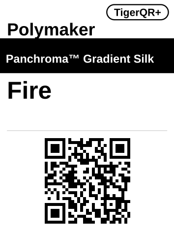 | [TigerQR+](examples/spool/tigerqr-plus/label-vertical-bold-30x40.svg) · [TigerQR](examples/spool/tigerqr/label-vertical-bold-30x40.svg) |
| Vertical compact | `verticalCompact` | 25 × 40 | 0 | 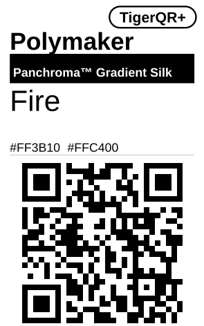 | [TigerQR+](examples/spool/tigerqr-plus/label-vertical-compact-25x40.svg) · [TigerQR](examples/spool/tigerqr/label-vertical-compact-25x40.svg) |
| QR only | `qrOnly` | 25 × 30 | 0 | 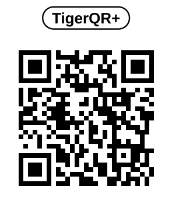 | [TigerQR+](examples/spool/tigerqr-plus/label-qr-only-25x30.svg) · [TigerQR](examples/spool/tigerqr/label-qr-only-25x30.svg) |

| Format | Layout |
|---|---|
| Classic (default) | brand, bar, colour and hex, four slots, QR bottom right |
| Wide | the Classic, with a wider bar |
| Compact | brand, QR left, bar, colour, hex |
| Slim | QR left, brand, bar, colour |
| Slicer-friendly | brand, series and colour stacked large, a big QR right |
| Vertical | brand, bar, colour large, hex, a rule, slots stacked left, QR bottom right |
| Vertical bold | brand, full-width bar, colour, a rule, QR centred below |
| Vertical compact | brand, bar, colour, hex, a rule, a big QR below |
| QR only | the pill centred at the top over a 20 mm QR box, nothing else |

The value slots print, in order: nozzle, bed and drying temperatures, then the TD when the product
has one, else the diameter. The Filament Label QR is
`https://qr.tigertag.io/p/0027996997`; the Spool Label QR is the TigerData spool link
`https://qr.tigertag.io/17941702052264512`. See [`examples/`](examples/).

---

## How a label is drawn

| Rule | Why |
|---|---|
| **One byte-mode segment** of the whole link, lowercase | A lowercase scheme cannot use the alphanumeric mode, and splitting the link into segments saves nothing. |
| **Error correction M** (15 %) | Labels get scratched and folded. |
| **29 × 29 modules** (version 3) for every spool and product link | The same code size whatever the link. |
| **Lowercase, always** | Tested 2026-11-07: the iPhone camera opens a link in either case, but the Samsung camera (Galaxy S24) shows an uppercase `HTTPS://` link as plain text and opens only a lowercase one. |
| **Whole printer dots per module** | Each module covers a whole number of dots: the nearest one that fills the QR box, rounded up when that stays within 6 % of the box, down otherwise. The code stays sharp on a thermal printer. |
| **203 or 300 dpi** | One SVG per label, sized in millimetres, laid out in tenths of a millimetre and scaled to printer dots. A PNG is drawn at exactly the label's size in dots, never resampled. |
| **The margins are the quiet zone** | The label's white margins are the QR's quiet zone. |
| **Texts keep clear** | Texts never run over the QR or the pill: a long text shrinks first, then is narrowed. |

Tiger Studio and tigersystem.io draw the same SVG, byte for byte, for the same label, format and
resolution.

**Printer dots per module**, for a 29 × 29 code:

| Format | 203 dpi: label, module, QR side | 300 dpi: label, module, QR side |
|---|---|---|
| Classic | 320 × 240 dots, 4 dots, 14.5 mm | 472 × 354 dots, 6 dots, 14.7 mm |
| Wide | 400 × 240 dots, 4 dots, 14.5 mm | 591 × 354 dots, 6 dots, 14.7 mm |
| Compact | 320 × 200 dots, 4 dots, 14.5 mm | 472 × 295 dots, 6 dots, 14.7 mm |
| Slim | 320 × 96 dots, 3 dots, 10.9 mm | 472 × 142 dots, 4 dots, 9.8 mm |
| Slicer-friendly | 320 × 240 dots, 5 dots, 18.1 mm | 472 × 354 dots, 8 dots, 19.6 mm |
| Vertical | 240 × 320 dots, 4 dots, 14.5 mm | 354 × 472 dots, 5 dots, 12.3 mm |
| Vertical bold | 240 × 320 dots, 4 dots, 14.5 mm | 354 × 472 dots, 6 dots, 14.7 mm |
| Vertical compact | 200 × 320 dots, 5 dots, 18.1 mm | 295 × 472 dots, 8 dots, 19.6 mm |
| QR only | 200 × 240 dots, 5 dots, 18.1 mm | 295 × 354 dots, 8 dots, 19.6 mm |

When you print a label, check it with a phone camera before you stick a batch: a printer that
smears dots, or a label scaled to fit a page, is the usual cause of a QR that will not read.

---

## Reading a link

A reader handed a link drops one leading `/<lang>/`, then reads the path case-insensitively,
ignores a trailing `/` and one ending (`.json` or `.ttag`), and matches what is left in this order:

| Path | Names | Notes |
|---|---|---|
| `p/<8 hex>` | a product, `id_product` = the hex value | Labels printed before the decimal form. Exactly 8 digits are read as hex first; the server tries the decimal reading when the hex one is not in the catalogue. |
| `p/<1 to 10 digits>` | a product, `id_product` = the decimal value | Printed as 10 digits, zero-padded: `p/0010303748`. |
| `p/00000000`, `p/0`, `p/ffffffff`, `p/4294967295` | "no product" | Never printed; answers `404`. |
| `p/<above 4294967295>` | unknown | Answers "update the app". |
| `<10 digits>` or `<17 digits>` | a spool without a chip | Inventory id: `TigerData_<digits>`. |
| `<14 hex>` | a spool with a chip | The chip UID. Inventory id: the UID in uppercase. |
| `<13 hex starting with 4>` | a spool with a chip | An NTAG UID that lost its leading 0: the 0 is put back. |
| `tigerdata_<digits>`, `tigerdata-<digits>` | a spool without a chip | The long form, typed or shared by hand. |
| anything else | unknown | A label from a newer version: "update the app" (`404`). |

Because a chip UID has 14 characters and a TigerData id 10 or 17 digits, an all-digit UID is never
read as a TigerData id. A product link always starts with `p/`, so it never collides with a spool.

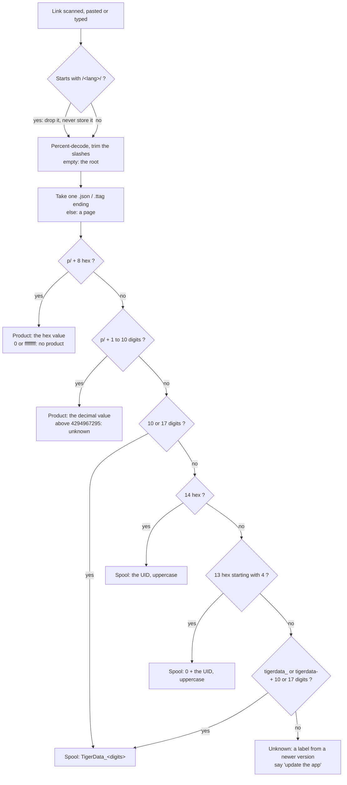

## Building a link

| From | Printed link |
|---|---|
| Chip UID `1D33DBDA0D1080` (inventory id) | `https://qr.tigertag.io/1d33dbda0d1080` (lowercase) |
| TigerData id `TigerData_6130922252` | `https://qr.tigertag.io/6130922252` (prefix removed) |
| `id_product` 10303748 | `https://qr.tigertag.io/p/0010303748` (decimal, 10 digits) |
| `id_product` 0 or 4294967295 | no link: these mean "unset" |

`CLOUD_` ids and legacy decimal ids get no QR link. The
[link generator](https://tigertag-project.github.io/TigerQR-Label/#generator) on the reference
site runs this code in the browser.

---

## Code examples

### TypeScript: read a link

The reference reader, [`src/parse.ts`](src/parse.ts), is the code `qr.tigertag.io` runs. It is
pure: no I/O, no dependency.

```ts
import { parseQrPath, splitLangPrefix } from "./src/parse";

// A shared link: drop the language first, then read the path.
const { lang, path } = splitLangPrefix("/fr/p/2673739332");
// lang: "fr", path: "/p/2673739332"
parseQrPath(path);
// { kind: "product", idProduct: 2673739332, hex: "9f5e0644", format: "page" }

parseQrPath("/4ab12cd3e4f80");
// { kind: "spool", spoolId: "04AB12CD3E4F80", format: "page" }   (the leading 0 put back)
parseQrPath("/TigerData-17623456789014213.JSON");
// { kind: "spool", spoolId: "TigerData_17623456789014213", format: "json" }
parseQrPath("/r/12");
// { kind: "unknown", format: "page" }   (a newer label: "update the app")
```

### TypeScript: build a link

The reference builder is [`src/links.ts`](src/links.ts).

```ts
import { productLink, qrLinkFrom, sharedLink, spoolLink } from "./src/links";

productLink(10303748);              // "https://qr.tigertag.io/p/0010303748"
productLink(0);                     // null: "unset", no label
spoolLink("TigerData_6130922252");  // "https://qr.tigertag.io/6130922252"
spoolLink("1D33DBDA0D1080");        // "https://qr.tigertag.io/1d33dbda0d1080"

// Whatever someone typed: a bare id of the given kind, or a whole link.
qrLinkFrom("chip", "1D:33:DB:DA:0D:10:80");
// { kind: "chip", link: "https://qr.tigertag.io/1d33dbda0d1080" }
qrLinkFrom("product", "https://qr.tigertag.io/fr/p/9f5e0644");
// { kind: "product", link: "https://qr.tigertag.io/p/2673739332" }

// To share, never to print:
sharedLink("https://qr.tigertag.io/p/2673739332", "fr");
// "https://qr.tigertag.io/fr/p/2673739332"
```

### Another language: a minimal reader in Python

A sketch of the same reading order. It gives every `expect` of the `read` and `lang` sections of
the test vectors.

```python
import re
from urllib.parse import unquote

LANG = re.compile(r"^/*(en|fr|de|es|it|zh|pt-pt|pt|pl|ru|nl)(?=/|$)", re.I)

def split_lang_prefix(path):
    m = LANG.match(path)
    return (m.group(1).lower(), path[m.end():] or "/") if m else (None, path)

def spool_id(p):
    if re.fullmatch(r"\d{17}|\d{10}", p):
        return "TigerData_" + p
    if re.fullmatch(r"[0-9a-f]{14}", p, re.I):
        return p.upper()
    if re.fullmatch(r"4[0-9a-f]{12}", p, re.I):
        return ("0" + p).upper()          # a truncated NTAG UID
    m = re.fullmatch(r"tigerdata[_-](\d{17}|\d{10})", p, re.I)
    return "TigerData_" + m.group(1) if m else None

def parse_qr_path(raw):
    try:
        p = unquote(raw, errors="strict")
    except UnicodeDecodeError:
        p = raw
    p = p.strip("/")
    if not p:
        return {"kind": "root"}
    fmt = "page"
    m = re.search(r"\.(json|ttag)$", p, re.I)
    if m:
        fmt, p = m.group(1).lower(), p[: m.start()]
    m = re.fullmatch(r"p/([0-9a-f]{8})", p, re.I)
    if m:                                 # older labels: 8 hex
        h = m.group(1).lower()
        n = int(h, 16)
        if n in (0, 0xFFFFFFFF):
            return {"kind": "no-product", "format": fmt}
        out = {"kind": "product", "idProduct": n, "hex": h, "format": fmt}
        if h.isdigit() and 0 < int(h) != n:
            out["idProductAlt"] = int(h)  # tried when the hex one is not in the catalogue
        return out
    m = re.fullmatch(r"p/(\d{1,10})", p, re.I)
    if m:                                 # printed form: decimal, 10 digits
        n = int(m.group(1))
        if n > 0xFFFFFFFF:
            return {"kind": "unknown", "format": fmt}
        if n in (0, 0xFFFFFFFF):
            return {"kind": "no-product", "format": fmt}
        return {"kind": "product", "idProduct": n, "hex": f"{n:08x}", "format": fmt}
    sid = spool_id(p)
    return {"kind": "spool", "spoolId": sid, "format": fmt} if sid else {"kind": "unknown", "format": fmt}

lang, path = split_lang_prefix("/fr/p/2673739332")
print(lang, parse_qr_path(path))
# fr {'kind': 'product', 'idProduct': 2673739332, 'hex': '9f5e0644', 'format': 'page'}
```

---

## Testing against the test vectors

[`test-vectors/links.json`](test-vectors/links.json) is generated from the reference code and
lists every link shape with the exact answer it must give:

| Section | Each case | Checks |
|---|---|---|
| `read` | `path` → `expect` | `parseQrPath(path)` |
| `lang` | `path` → `expect` (`lang`, `path`) | `splitLangPrefix(path)` |
| `build` | `kind`, `input` → `expect` (`kind`, `link`) | `qrLinkFrom(kind, input)` |
| `spoolLink` | `docId` → `expect` | `spoolLink(docId)` |
| `productLink` | `id_product` → `expect` | `productLink(id_product)` |
| `sharedLink` | `link`, `lang` → `expect` | `sharedLink(link, lang)` |

Run the reference code against every vector (Node 22.13 or later, no install):

```bash
git clone https://github.com/TigerTag-Project/TigerQR-Label
cd TigerQR-Label
node tools/check.mjs
# ok: 73 test vectors pass; ...
```

A reader in another language passes when it gives every `expect` of the `read` and `lang`
sections, compared as JSON (an absent `idProductAlt` stays absent). Load the file, run each
`path` through your reader and compare; the `build` sections apply to apps that print links.
`tools/check.mjs` also runs on every pull request ([`check.yml`](.github/workflows/check.yml)).

---

## Make a label

<p align="center">
  <a href="https://tigersystem.io/playground-tigerqr">
    
  </a>
</p>

- **On the web, from the catalogue, every format at once:** the
  [TigerQR Playground](https://tigersystem.io/playground-tigerqr) makes a catalogue product's
  TigerQR+ label in every format, as PNG (203 or 300 dpi) and SVG.
- **In Tiger Studio:** the Spool Label for your own spool, the Filament Label for a catalogue
  product, as PDF, PNG at the printer's resolution, or SVG.
- **The labels explained, with a link generator:**
  [tigersystem.io/en/tiger-qr-labels](https://tigersystem.io/en/tiger-qr-labels).
- **From code:** the public label API below.

## The public label API

Any catalogue product's label from its id alone, drawn by tigersystem.io with the renderer Tiger
Studio uses. No key, no sign-in.

```
GET https://tigersystem.io/api/public/v1/label/<id>.svg?template=<format>&dpi=<203|300>
GET https://tigersystem.io/api/public/v1/label/<id>.json
GET https://tigersystem.io/api/public/v1/label/<id>.html
```

| Request | Answer | Parameters |
|---|---|---|
| `<id>.svg` | the label, sized in millimetres | `template`: a format id (`classic` by default); `dpi`: `203` or `300`; `unit=dots`: sized in printer dots instead (a PNG's source); `lang`: the language of the slot words |
| `<id>.json` | what the label prints (brand, series, material, colours, values), its QR link, its catalogue page, and the SVG URL of every format | `lang` |
| `<id>.html` | a widget to frame on any site | `template`, `dpi`, `lang`, `theme=light` or `dark` |

Examples: [`2673739332.svg?template=qrOnly`](https://tigersystem.io/api/public/v1/label/2673739332.svg?template=qrOnly),
[`27996997.svg?template=classic&dpi=300`](https://tigersystem.io/api/public/v1/label/27996997.svg?template=classic&dpi=300),
[`27996997.json`](https://tigersystem.io/api/public/v1/label/27996997.json),
[`27996997.html`](https://tigersystem.io/api/public/v1/label/27996997.html). An unknown id
answers `404`. The widget is documented on [tigersystem.io/en/embed](https://tigersystem.io/en/embed).

---

## Repository layout

| Path | What it is |
|---|---|
| [`spec/links.md`](spec/links.md) | The `qr.tigertag.io` links: how they are read, who gets what, how they are built |
| [`spec/labels.md`](spec/labels.md) | The nine label formats and how a label is drawn |
| [`test-vectors/links.json`](test-vectors/links.json) | Every link shape with the answer it must give |
| [`src/`](src/) | The reference code that reads and builds the links, the code `qr.tigertag.io` runs |
| [`examples/`](examples/) | The nine formats, as a Filament Label and as a Spool Label (TigerQR+ and TigerQR) |
| [`assets/`](assets/) | The illustrations of this README and of the reference site |
| [`site/`](site/) | The reference site, published on GitHub Pages by [`pages.yml`](.github/workflows/pages.yml) |
| [`tools/`](tools/) | `check.mjs` (test vectors, links, no emoji) and `build-site.mjs` (the site) |
| [`llms.txt`](llms.txt) | The same facts for AI assistants |
| [`brand/`](brand/) | The logos, under the TigerTag brand rules |

Build the site locally:

```bash
node tools/build-site.mjs && python3 -m http.server 8000 --directory _site
```

## Related

- [TigerQR Playground](https://tigersystem.io/playground-tigerqr): every format of a catalogue product's label, PNG and SVG
- [TigerQR labels on tigersystem.io](https://tigersystem.io/en/tiger-qr-labels): the labels explained, and a link generator
- [Spool ids and QR links](https://wiki.tigersystem.io/developers/spool-ids-and-qr-links/): the full link contract, with every edge case
- [TigerTag-RFID-Guide](https://github.com/TigerTag-Project/TigerTag-RFID-Guide): the TigerTag chip protocol ([site](https://tigertag-project.github.io/TigerTag-RFID-Guide/))
- [Tiger Studio](https://github.com/TigerTag-Project/TigerTag-Studio-Manager): prints the Spool Label and the Filament Label
- [Label widget and API](https://tigersystem.io/en/embed): frame a product's label on any site
- [TigerSystem-Docs](https://github.com/TigerTag-Project/TigerSystem-Docs): the documentation of the ecosystem ([wiki.tigersystem.io](https://wiki.tigersystem.io))

## Licence

Documentation, examples and test vectors: CC-BY-4.0. Code in `src/`: Apache-2.0. Implementing
these links and labels needs no licence and no payment. The logos in `brand/` are not covered.
Details in [LICENSING.md](LICENSING.md).
